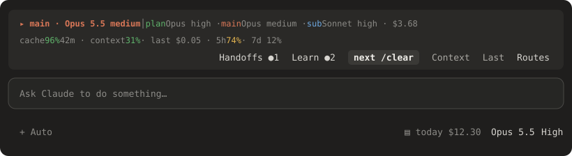

# model-router

A Claude Code mod that picks the model and effort per kind of work: plan mode, normal work, and each subagent type. It includes a cache-aware auto mode and per-route cost tracking.



## Install

At the prompt of a terminal Claude Code session:

```
/plugin install model-router --marketplace TFoxik/claude-model-router
```

Answer `y` to add the marketplace, then choose a scope (user scope loads it in every session).

## What you get

- **Band above the prompt**: the route the last request used, the configured plan / main / sub routes, and the session cost. Buttons open the pane or hide the band.
- **Footer**: `cache 96% 42m · ctx 31% · 5h 38% · last $0.05`, coloured by health. `42m` is how long the prompt cache stays warm since the last main-loop request, and it turns to `cold` once that runs out. `last` is the cost of your whole last prompt: every main-loop request plus every subagent it started (for example all four `/simplify` agents and the fixes), growing live while the prompt runs. Click it to open a breakdown: main loop and each subagent with its model, requests, tokens and cost.
- **`/route` pane**: model and effort per route, presets, and a per-route spend table. Edits stay a draft until you press **Apply**. The draft shows the per-turn cost change, the one-off cache rewrite cost, the plan-mode toggle cost and the payback.

## Commands

| Command | Effect |
|---|---|
| `/route` | Open the pane |
| `/route preset mine\|balanced\|frugal\|max` | Apply a preset |
| `/route set <route> <model> [effort]` | Set one route now, for example `/route set sub:Explore haiku low` |
| `/route on` / `/route off` | Enable or disable routing |
| `/route band on\|off` | Show or hide the band |
| `/route ttl 5\|60` | Prompt-cache lifetime used for the warm/cold timer (default 60) |

Routes: `main`, `plan`, `sub:*`, `sub:Explore`, `sub:Plan`, `sub:general-purpose`, `sub:<any-agent-type>`, `workflow`, `teammate`.
Models: `opus`, `sonnet`, `haiku`, `fable`, `inherit`. Efforts: `low` through `max`, `auto` (main and plan only), `inherit`.

## Notes

- Prompt caches are tied to one model and effort. Changing the route the main loop is on rewrites the cache once. The pane shows that cost before you apply.
- Subagents start with a fresh context, so routing them to cheaper models costs nothing up front.
- Forks always inherit the parent's model.
- Prices are hard-coded in `hooks/routes.ts` (as of 2026-10-06). Cache writes are priced by the `/route ttl` setting: 2× input for the 1-hour cache (default), 1.25× for the 5-minute one. The costs shown are estimates.

## Develop

```
claude --plugin-dir .
claude plugin validate .
claude plugin test .
```
