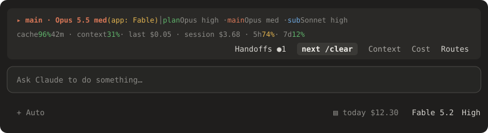
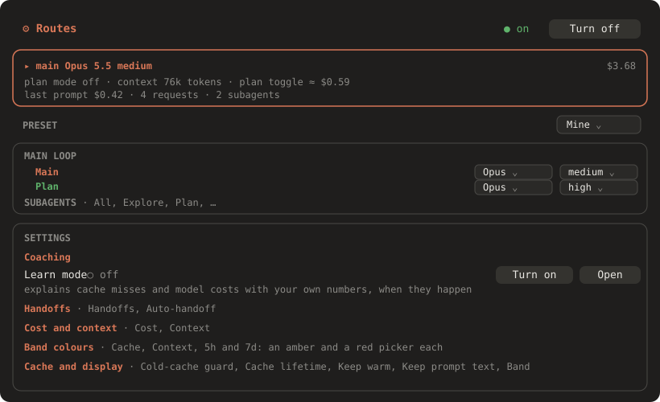

# model-router

A Claude Code mod that picks the model and effort for each kind of work, and shows what those choices cost.

Plan mode, normal work and each subagent type can run on a different model: Opus for planning, Sonnet for edits, Haiku for searches. The mod tracks prompt-cache health and spend as you go, stops a send that would re-write a cold cache, and can explain where your money went with your own numbers.



The **[field guide](https://tfoxik.github.io/claude-model-router/)** walks through every part of the screen it adds, with annotated pictures.

## What it does

- **Routes models per kind of work.** A model and effort for `main`, `plan`, each subagent type, workflows and teammates, or a preset. The `/route` pane shows what a change costs before you apply it. When a route replaces the model the app would use, the band says so in amber: `▸ main · Opus 5.5 med (app: Fable)`. Set that route to `inherit`, or `/route off`, to let the app decide. [More](https://tfoxik.github.io/claude-model-router/#routes)
- **Shows cache and cost health in a band**: `cache 96% 42m · context 31% · last $0.05 · session $1.23 · 5h 38% · 7d 12%`. Each percentage turns amber and red at thresholds you can change. [More](https://tfoxik.github.io/claude-model-router/#band)
- **Says when to compact, clear or hand off**, as a `next /clear`, `next /compact` or `next /handoff` button, with the reason in dollars in the Context pane. [More](https://tfoxik.github.io/claude-model-router/#context)
- **Guards cold sends.** When the cache has expired over a big context, your next message is held once with its price; send it again to pay, or `/clear`. [More](https://tfoxik.github.io/claude-model-router/#guard)
- **Keeps handoffs.** Optionally saves one while the cache is still warm and work is open, and lists them in `/route handoffs` to resume or close. [More](https://tfoxik.github.io/claude-model-router/#handoffs)
- **Spots MCP servers, plugins and skills you don't use** in a repo, and puts the command that turns each off in your prompt. It changes nothing itself. [More](https://tfoxik.github.io/claude-model-router/#unused)
- **Shows where the money went**: the last prompt, this session, and a history across sessions of which commands and prompts cost most. [More](https://tfoxik.github.io/claude-model-router/#cost)
- **Keeps the cache warm while you're away**, if you ask, and compares the cheapest ways to step away. [More](https://tfoxik.github.io/claude-model-router/#away)
- **Teaches, if you want it to.** Learn mode explains each cache miss, model switch and expensive prompt with the real numbers, in a card above the band. [More](https://tfoxik.github.io/claude-model-router/#learn)



## Install

Needs Claude Code 2.1.287 or later. At the prompt of a terminal Claude Code session:

```
/plugin install model-router --marketplace TFoxik/claude-model-router
```

Or from a shell:

```
claude plugin marketplace add TFoxik/claude-model-router
claude plugin install model-router@claude-model-router
```

A fresh install changes no model: it starts on the `inherit` preset, which only tracks costs. Run `/route preset mine`, or pick a preset in `/route`, to start routing. New to prompt caching? `/route learn on`.

**Update:** turn on auto-update once in `/plugin` (**Marketplaces** → `claude-model-router` → **Enable auto-update**), or by hand:

```
claude plugin marketplace update claude-model-router
claude plugin update model-router@claude-model-router
```

Then restart or `/reload-plugins`. Settings carry over. See [CHANGELOG.md](CHANGELOG.md).

## Commands

| Command | Effect |
|---|---|
| `/route` | Open the Routes pane: routing on top, every setting below |
| `/route preset inherit\|mine\|balanced\|frugal\|max` | Apply a preset (`inherit` only tracks) |
| `/route set <route> <model> [effort]` | Set one route, e.g. `/route set sub:Explore haiku low` |
| `/route on` / `off` | Turn routing on or off |
| `/route features` | The five features (routing, context, cost, handoffs, learn), each on or off |
| `/route cost\|context\|handoffs\|learn on\|off` | Turn a feature on or off |
| `/route cost [last\|session\|history]` / `last` / `stats` / `context` | Open the Cost pane on a tab, or the Context pane |
| `/route stats clear` / `stats text on\|off` | Delete prompt history / keep prompt text in it (default on) |
| `/route learn mute\|unmute <topic>` | Silence a learn-mode topic |
| `/route next on\|off` | Show or hide the `next …` advice (default on) |
| `/route handoffs` / `handoffs auto on\|off` | Open the Handoffs pane / save handoffs before the cache goes cold (default off) |
| `/route away` | The ways to step away, priced for this session |
| `/route warm [<n>h]` / `warm stop` | Keep the cache warm while away (default 4 h, at most 6; 60-minute cache only) |
| `/route warm auto on\|off` | Start keep warm by itself when a session sits idle (all sessions; off by default) |
| `/route unused` | What this repo leaves unused, and how to turn it off |
| `/route guard refuse\|warn\|off` | What a send onto a cold cache does (default `refuse`) |
| `/route ttl 5\|60` | Prompt-cache lifetime in minutes (default 60) |
| `/route band on\|off` | Show or hide the band |
| `/route levels [cache\|context\|limits <amber> <red> \| reset]` | Where the band turns amber and red (defaults: cache 80/50, context 60/85, 5h and 7d 70/90) |

Routes: `main`, `plan`, `sub:*`, `sub:<agent-type>`, `workflow`, `teammate`. Models: `opus`, `sonnet`, `haiku`, `fable`, `inherit`. Efforts: `low` to `max`, `auto` (main and plan only), `inherit`. Most settings are also rows in the Routes pane.

## Good to know

- **Switching the main loop's model or effort rewrites the cache once**, at 1.25–2× input over the whole context; the pane shows the cost first. Rerouting subagents is free.
- **Prices are estimates**, hard-coded in `hooks/core/pricing.ts`. Model IDs are the Anthropic API's; on another provider, turn routing off or set routes to `inherit`.
- **The guard works from the band's clock**, not a server check.

## Overhead and privacy

- **No tokens added**: no system prompt or attachments.
- **Three optional model calls**, off unless you pick them: `auto` effort sends the first 4,000 characters of each prompt to Haiku to classify it (about $0.0001); auto-handoff sends one handoff request when the cache is about to go cold with work open; keep warm sends `Reply with OK.` about once an hour, billed as a cache read of the whole context.
- **Stored locally** in the plugin store: prompt history (first 120 characters, repo, cost, models; last 2,000), learn-mode lessons (numbers only), handoff records, and per repo which MCP servers, plugins and skills were loaded and used. `/route stats text off` drops prompt text; `/route stats clear` deletes the history.
- **Files:** it writes only under `~/.claude/handoffs/`, and reads `~/.claude/skills`, `~/.claude/commands` and `~/.agents/.skill-lock.json`. It never reads your transcripts.
- **No network or process access of its own.** Nothing leaves your machine except the model calls above, which go through Claude Code.
- **Settings change only when you type a command or use a pane control**, never from a peer session, channel or trigger.

## Develop

```
scripts/try.sh [folder]
claude plugin validate .
claude plugin test .
```

`scripts/try.sh` starts Claude in `folder` with this checkout in place of the installed mod, for that session only; `/reload-plugins` there picks up edits. `MODEL_ROUTER_IDLE_DEV=1 scripts/try.sh` shows the unused-items advice without two weeks of history.

## License

MIT, see [LICENSE](LICENSE).
