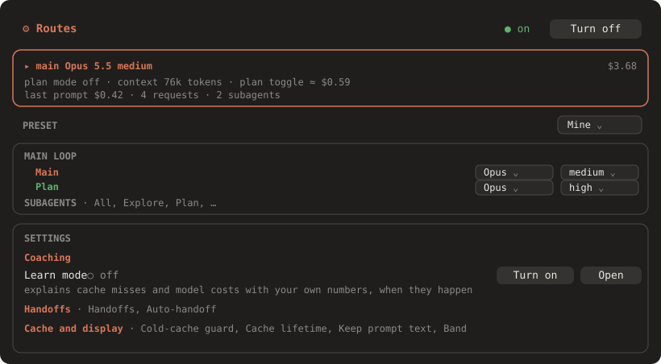
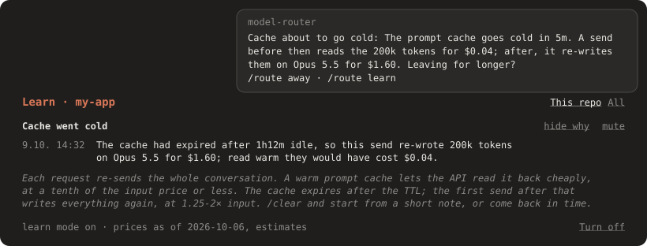

# model-router

A Claude Code mod that picks the model and effort for each kind of work, and shows what those choices cost.

Plan mode, normal work and each subagent type can run on a different model: Opus for planning, Sonnet for edits, Haiku for searches. The mod tracks prompt-cache health and spend as you go, stops a send that would re-write a cold cache, and can explain where your money went with your own numbers.


The **[field guide](https://tfoxik.github.io/claude-model-router/)** walks through every part of the screen it adds, with annotated pictures.

## What it does

- **Routes models per kind of work.** Set a model and effort for `main`, `plan`, each subagent type (`sub:Explore`, `sub:Plan`, …), workflows and teammates, or pick a preset. The `/route` pane shows what a change costs per turn, the one-off cache rewrite it causes, and when it pays back, before you apply it.
- **Shows cost and cache health in a band above the prompt**: `cache 96% 42m · context 31% · last $0.05 · session $1.23 · 5h 38% · 7d 12%`. That's the cache hit rate and minutes until it goes cold, context used, the cost of your last prompt and of this session, and your 5-hour and 7-day limits. The band's last line has **Context** and **Cost** for a breakdown with tips on what to trim or reroute.
- **Says when to carry on, compact, clear or hand off.** When carrying on is not the best move, the band's last line shows a `next /clear`, `next /compact` or `next /handoff` button:
  - **Clear** after a commit or pull request over a sizeable context, once the cache has gone cold, once a plan is written to disk (implement it in a fresh context), or after two corrections in a row (start over with a better prompt).
  - **Hand off** instead of clearing after a commit or compacting when two or more todos or tasks are still open: a written handoff keeps the plan's detail, a summary does not. It names your `/handoff` skill when you have one.
  - **Compact** when auto-compact is close or the conversation fills most of the context.
  - The Context pane's tips give the reason in dollars, and suggest a subagent when reads and searches fill the main context.
  - It shows with learn mode on or off. `/route next off`, or the Routes pane's **Next-step advice** row, hides it.
- **Saves a handoff before the cache goes cold, if you want it to.** With `/route handoffs auto on`, when the cache is in its last minutes and work is still open, it asks Claude for a handoff while reading the context is still cheap and saves it under `~/.claude/handoffs/<repo>/`. Once per prompt; it never clears the session itself.
- **Keeps a list of handoffs.** `/route handoffs` lists the handoffs in `~/.claude/handoffs/<repo>/`, saved by auto-handoff or your own `/handoff`, each in its own box with its title, a few lines on what it is about (the first paragraph under its `## Goal`, or after the title) and up to six of its open steps (the list under its `## Open steps`). Each open one has **Resume** (fills the prompt with `resume from <path>`), **Done** and **Not relevant**. A handoff closes on its own when a newer one is saved in the same session, or when you send a prompt naming it; one left open for 14 days folds away as stale. The band shows `Handoffs ●N` while other sessions' handoffs are open in this repo. `/route handoffs off`, or the Routes pane's **Handoffs** row, turns the whole feature off: no count in the band and no auto-handoff. Files are never edited or deleted; to prune old ones: `find ~/.claude/handoffs -name '*.md' -mtime +30 -delete`.
- **Spots MCP servers, plugins and skills you don't use.** It notes, per repo, which MCP servers, plugins and personal skills and commands (everything in `~/.claude/skills` and `~/.claude/commands`, downloaded ones included) are loaded and which get used. It also tracks the skills synced from your claude.ai account. A plugin's skills count toward the plugin; project skills and Claude Code's built-in ones aren't tracked. Once one has been loaded for two weeks and ten sessions without use in 30 days, the Context pane's **Unused MCP servers, plugins and skills** section and `/route unused` name it with the fix. Anything newer isn't judged yet. The mod changes nothing itself: a tip's button puts the command in your prompt, and it runs only when you press Enter.
  - **MCP servers** go off per repo in `/mcp`. When none of your connected claude.ai connectors is used, it also offers `"disableClaudeAiConnectors": true`.
  - **Plugins**: **Disable here** fills `claude plugin disable <id> --scope local`, which writes `false` to the repo's `.claude/settings.local.json`; **Disable everywhere** fills `--scope user`. `/route unused` also prints the `enabledPlugins` block to paste. A plugin listed covers its own MCP server.
  - **Personal skills and commands** can't be switched off for one repo. One no repo uses gets **Archive**, which moves it to `~/.claude/skills-archive` (move it back to restore). One only this repo uses gets **Move here**, which makes it a project skill so other repos stop loading it. A skill the `skills` CLI installed is named with its source, from `~/.agents/.skill-lock.json`; archiving it moves only Claude Code's link.
  - **claude.ai skills** are switched on and off on claude.ai, for every repo at once. Ones no repo uses share one tip that points to claude.ai/customize/skills; Claude Code drops a skill switched off there at its next sync. When most of them are unused, it also names `"syncClaudeAiSkills": false`, which stops syncing all of them.
  - A claude.ai connector counts once, whether the CLI (`claude.ai Figma`) or the desktop app (an id) loaded it. Connectors you never signed in to, and claude.ai's own Visualize, aren't counted. A plugin's hooks can't be seen, so plugins with only hooks are never listed.
- **Shows where the money went, in one Cost pane.** Its tabs are **Last prompt** (each request and subagent, with tips), **Session** (spend per route) and **History**, kept across sessions: which commands cost most on average and your most expensive prompts, with the models each one used, for this repo or all repos. **Cost** in the band opens it on Last prompt; the footer's `▤ today $12.30` opens History.
- **Guards cold sends.** When the cache has expired over a big context, your next message is held once with its price: `This send re-writes ~200k tokens on Opus 5.5 = $1.60 (warm would be $0.04)`. Send it again to pay, or `/clear`.
- **Teaches, if you want it to.** Learn mode (off by default) explains each cache miss, model switch, growing context and expensive prompt with the real numbers, warns before the cache goes cold, and says why a commit is a good moment to `/clear`. The lesson shows as a card above the band right when it applies, and goes away when you send your next prompt. **Mute topic** on the card silences that kind of lesson. Three habits no hook can spot are worth keeping anyway: `/clear` between unrelated tasks, `/btw` for side questions, and Esc Esc to rewind. `/route away`, and the Context pane's **Before a break** box once the context is big, compare the cheapest ways to step away from a session.





## Install

Needs Claude Code 2.1.287 or later (tested with 2.1.294). At the prompt of a terminal Claude Code session:

```
/plugin install model-router --marketplace TFoxik/claude-model-router
```

Answer `y` to add the marketplace, then pick a scope (user scope loads it in every session). Or from a shell:

```
claude plugin marketplace add TFoxik/claude-model-router
claude plugin install model-router@claude-model-router
```

A fresh install changes no model: it starts on the `inherit` preset, which only tracks costs. Run `/route preset mine`, or pick a preset in `/route`, to start routing. New to prompt caching? Turn on learn mode with `/route learn on`.

### Update

Claude Code doesn't auto-update third-party marketplaces unless you turn it on. Once, in `/plugin`: **Marketplaces** → `claude-model-router` → **Enable auto-update**. New sessions then pick up each release at startup; open ones need `/reload-plugins`.

To update by hand instead:

```
claude plugin marketplace update claude-model-router
claude plugin update model-router@claude-model-router
```

Then restart or run `/reload-plugins`. Saved settings carry over. See [CHANGELOG.md](CHANGELOG.md) for what changed.

## Commands

| Command | Effect |
|---|---|
| `/route` | Open the Routes pane: routing on top, every setting below it |
| `/route preset inherit\|mine\|balanced\|frugal\|max` | Apply a preset (`inherit` changes no model, it only tracks) |
| `/route set <route> <model> [effort]` | Set one route, for example `/route set sub:Explore haiku low` |
| `/route on` / `off` | Enable or disable routing |
| `/route cost [last\|session\|history]` | Open the Cost pane, on a tab |
| `/route last` / `stats` / `context` | Open Cost on Last prompt, Cost on History, or the Context pane |
| `/route stats clear` | Delete the saved prompt history |
| `/route stats text on\|off` | Keep the first 120 characters of each prompt in Cost › History (default on); off also removes text already kept |
| `/route learn` / `learn on\|off` | Show whether learn mode is on and which topics are muted / turn learn mode on or off (default off) |
| `/route learn mute\|unmute <topic>` | Silence a topic: `cold-rewrite`, `switch-rewrite`, `pricey-model`, `context-high`, `compacted`, `subagents`, `cache-expiring`, `plan-toggle`, `strategy`, `handoff`, `plan-ready`, `corrections`, `exploration`, `auto-handoff` |
| `/route next on\|off` | Show or hide the band's `next /clear`, `/compact` or `/handoff` and the Context pane's advice tip (default on) |
| `/route handoffs` / `handoffs on\|off` | Open the Handoffs pane: open handoffs to resume, mark done or not relevant / turn handoffs on or off: the band's count and auto-handoff (default on) |
| `/route handoffs auto on\|off` | Save a handoff while the cache is still warm, before it goes cold with work open (default off) |
| `/route away` | Before a break: the ways to step away, priced for this session; also in the Context pane |
| `/route unused` | MCP servers, plugins and skills this repo has long left unused, and the command that turns each off |
| `/route guard refuse\|warn\|off` | What a send onto a cold cache does (default `refuse`: held once with its price); also the Routes pane's **Cold-cache guard** row |
| `/route ttl 5\|60` | Prompt-cache lifetime for the warm/cold timer (default 60); also the Routes pane's **Cache lifetime** row |
| `/route band on\|off` | Show or hide the band; also the Routes pane's **Band** row. Routing works either way |

Routes: `main`, `plan`, `sub:*`, `sub:<agent-type>` (such as `sub:Explore`), `workflow`, `teammate`. Models: `opus`, `sonnet`, `haiku`, `fable`, `inherit`. Efforts: `low` through `max`, `auto` (main and plan only), `inherit`.

## Good to know

- **Switching the main loop's model or effort rewrites the cache once**, at 1.25-2× input over the whole context. The pane shows that cost before you apply. With plan and main routed differently, entering and leaving plan mode each pay it.
- **Rerouting subagents is free**: they start with a fresh context. Forks always inherit the parent's model.
- **Prices are estimates**, hard-coded in `hooks/routes.ts` (as of 2026-10-06). Model IDs are the Anthropic API's; on a provider that names models differently, turn routing off or set routes to `inherit`.
- **The guard works from the band's clock**, not a server check, and doesn't keep the cache warm while you're away.

## Overhead and privacy

- **No tokens added**: no system prompt or attachments. Toasts, the band and the panes stay in the UI.
- **Two optional model calls**, both off unless you pick them:
  - `auto` effort (presets `balanced` and `frugal`) sends the first 4,000 characters of each prompt you type to Haiku to classify it, about $0.0001 and a few hundred milliseconds. Fixed efforts make no call.
  - Auto-handoff (`/route handoffs auto on`) sends one prompt asking for a handoff, at most once per prompt, when the cache is about to go cold with work open. It is a normal turn: it reads the context at the warm cache price and pays for the handoff it writes.
- **Stored locally** in the plugin store, across repos: prompt history for Cost › History (the first 120 characters of each prompt, repo name, cost, models; last 2,000 prompts), learn mode lessons (numbers and model names, never prompt text; last 20 per topic, kept to count how often each topic was shown), handoff records (path, title, a line or two of what it is about, status), per repo which MCP servers, plugins, personal skills and claude.ai skills were loaded and used (names, counts and dates, never tool arguments), and the name behind each connector id the desktop app uses.
- **Files: it writes only under `~/.claude/handoffs/`.** It lists and reads the handoffs there and, with auto-handoff on, writes new ones. It also reads the `.md.closed` markers other tools may leave beside a handoff, to show it as done. It never writes, edits or deletes a file it didn't write.
- **Other reads.** It lists `~/.claude/skills` and `~/.claude/commands` and reads `~/.agents/.skill-lock.json`, to know your personal skills and where the `skills` CLI installed them from. It never reads your transcripts.
- **No network or process access of its own.** Nothing leaves your machine except the model calls above, which go through Claude Code.
- **Settings change only when you type a command or use a pane control**, never from a peer session, channel or trigger. Opening a pane works from anywhere.

## Develop

```
scripts/try.sh [folder]
claude plugin validate .
claude plugin test .
```

`scripts/try.sh` starts Claude in `folder` (default: here) with this checkout in place of the installed mod, which stays off for that session only. `/reload-plugins` there picks up later edits. The local copy keeps its own saved state; files such as handoffs are shared. In this repo, asking Claude to "try it locally" opens that session in a new terminal tab.

To see the unused-items advice without two weeks of history, run `MODEL_ROUTER_IDLE_DEV=1 scripts/try.sh`. After its first prompt, `/route unused` and the Context pane list whatever was loaded but not used in the last 30 days.

## License

MIT, see [LICENSE](LICENSE).
