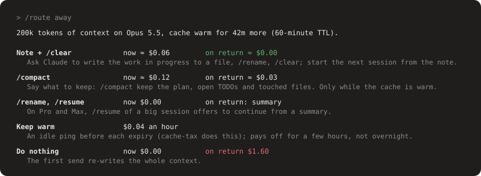

# model-router

A Claude Code mod that picks the model and effort per kind of work (plan mode, normal work, each subagent type) and shows what those choices cost. It tracks prompt-cache health and spend per route and per prompt, holds a send that would re-write a cold cache, and has an optional learn mode that explains cache misses and model costs with your own numbers.


The **[field guide](https://tfoxik.github.io/claude-model-router/)** walks through every part of the screen it adds, with annotated pictures.

## Install

Needs Claude Code 2.1.287 or later, the first release with mods. Tested with 2.1.294; the hook events and engine calls a mod uses can change between releases, so a newer Claude Code may need an update here.

At the prompt of a terminal Claude Code session:

```
/plugin install model-router --marketplace TFoxik/claude-model-router
```

Answer `y` to add the marketplace, then choose a scope (user scope loads it in every session).

From a shell instead:

```
claude plugin marketplace add TFoxik/claude-model-router
claude plugin install model-router@claude-model-router
```

To update, run `claude plugin marketplace update claude-model-router`, then `claude plugin update model-router@claude-model-router`, and restart Claude Code or run `/reload-plugins`. Saved settings carry over.

A fresh install starts on the `inherit` preset, which changes no model. Run `/route preset mine` (or pick one in `/route`) to start routing.

New to prompt caching or model costs? Turn on **Learn mode** in the `/route` pane (or `/route learn on`). It stays off until you do, and then explains each cache miss, model switch and expensive prompt with your own numbers, warns before the cache goes cold, and `/route away` shows the cheapest way to step away from a session.

See [CHANGELOG.md](CHANGELOG.md) for what changed in each version.

## What you get

- **Band above the prompt**, two rows:
  - Routing: the route the last request used, the configured plan / main / sub routes, the session's estimated total, and **Routes** / **Hide** buttons.
  - Health: `cache 96% 42m  ·  context 31%  ·  last $0.05  ·  5h 38%  ·  7d 12%`, coloured by health.
    - `cache` prompt-cache hit rate of the last main-loop request, and minutes until the cache goes `cold`. Once cold over a big context it shows what the next send would cost to re-write, for example `cold $1.60`.
    - `context` context used. Green until 60% of the way to auto-compaction, amber to 85%, red after. Click the word for a breakdown: categories, MCP servers, memory files, distance to auto-compact.
    - `last` cost of your whole last prompt (main loop plus every subagent it started), growing live. Click it for the per-agent breakdown.
    - `5h` / `7d` how much of the 5-hour and 7-day limits is used.
- **Footer**: `▤ today $12.30`, what you've spent today. Click it for **Stats**, kept across sessions for this repo or all repos: commands ranked by average cost per run (`/simplify`, `/code-review`, plain prompts…) and your most expensive prompts, each with the models and effort levels it used and what each cost, so you learn over time which calls are costly.
- **Cold-send guard**: when the cache has gone cold over 50k+ tokens of context, your next message is dropped once with its price, worked out for the model the next turn is routed to: `the prompt cache went cold 1h12m ago. This send re-writes ~200k tokens on Opus 5.5 = $1.60 (warm would be $0.04)`. Send it again to pay it, or `/clear`. Slash commands that reach the model are held the same way: user commands and MCP prompts always, and skills such as `/simplify` once the router has seen them start a model turn (a brand-new skill's first cold run goes through). Only what you type is held; notifications, triggers and peer messages always pass. `/route guard warn` only shows the price; `/route guard off` turns it off.
- **Cache rewrites in the cost panes**: a request that rebuilt the cache, because it went cold or because the route changed model or effort, is marked in **Last** and counted in **Stats** (`· 3 cache rewrites $4.20`), with what it cost above a warm read.
- **Learn mode** (off by default; turn it on in the `/route` pane or with `/route learn on`): when a cache rewrite, an expensive model, a growing context, a compaction or busy subagents cost you something, a toast explains it with the real numbers, for example `Cache went cold: … re-wrote 180k tokens on Opus 5.5 for $1.44; read warm they would have cost $0.04`. The first time a topic comes up the **Learn** pane explains the concept in full; after that only the numbers. At most one toast per turn, once an hour per topic, and a topic stops toasting after three times. A **Learn ●N** button in the band opens the pane while lessons are unread; it counts the ones that toasted and the first of each topic, not quiet repeats. Already know a topic, say Opus is pricey because you route it on purpose? **mute** it in the Learn pane (or `/route learn mute pricey-model`) and it stops recording, toasting and counting.
  - It also warns *before* a cost: 5 minutes before the cache goes cold while you're idle (2 on the 5-minute TTL), with what a send costs before and after; when plan mode is routed differently from normal work, what each switch rewrites, including the way back (the engine reports plan mode only with the send, so the first switch is already paid); and, when the cold-send guard holds a message, why.
  - **Stepping away?** `/route away` compares the ways to leave a session, priced for its context, routed model and cache: a note plus `/clear`, `/compact` while warm, `/rename` and `/resume`, keeping the cache warm with pings, or doing nothing. Based on Anthropic's [cost guidance](https://code.claude.com/docs/en/costs) and [session tips](https://claude.com/blog/maximizing-the-value-of-your-claude-code-sessions). The Sonnet comparison is price arithmetic only, not a quality claim.
- **`/route` pane**: model and effort per route, presets, a per-route spend table, and the learn mode switch. Edits stay a draft until you press **Apply**. The draft shows the per-turn cost change, the one-off cache rewrite cost, the plan-mode toggle cost and the payback.




## Commands

| Command | Effect |
|---|---|
| `/route` | Open the pane |
| `/route stats` / `context` / `last` | Open the Stats, Context or Last prompt cost pane (handy in the terminal) |
| `/route stats clear` | Delete the saved prompt history |
| `/route stats text on\|off` | Keep the first 120 characters of each prompt in Stats (default on); `off` also removes text already kept |
| `/route learn` | Open the Learn pane |
| `/route learn on\|off` | Turn learn mode on or off (default off) |
| `/route learn mute\|unmute <topic>` | Silence or bring back one topic: `cold-rewrite`, `switch-rewrite`, `pricey-model`, `context-high`, `compacted`, `subagents`, `cache-expiring`, `plan-toggle` |
| `/route away` | Before a break: the ways to step away, priced for this session |
| `/route preset inherit\|mine\|balanced\|frugal\|max` | Apply a preset (`inherit` changes no model, it only tracks) |
| `/route set <route> <model> [effort]` | Set one route now, for example `/route set sub:Explore haiku low` |
| `/route on` / `/route off` | Enable or disable routing |
| `/route band on\|off` | Show or hide the band |
| `/route guard refuse\|warn\|off` | What a send onto a cold cache does (default `refuse`: dropped once with its price) |
| `/route ttl 5\|60` | Prompt-cache lifetime used for the warm/cold timer (default 60) |

Routes: `main`, `plan`, `sub:*`, `sub:Explore`, `sub:Plan`, `sub:general-purpose`, `sub:<any-agent-type>`, `workflow`, `teammate`.
Models: `opus`, `sonnet`, `haiku`, `fable`, `inherit`. Efforts: `low` through `max`, `auto` (main and plan only), `inherit`.

## Notes

- Prompt caches are tied to one model and effort. Changing the route the main loop is on rewrites the cache once. The pane shows that cost before you apply.
- Subagents start with a fresh context, so routing them to cheaper models costs nothing up front.
- Forks always inherit the parent's model.
- The guard prices a cold send from the band's clock, not a server check. It doesn't keep the cache warm while you're away; [cache-tax](https://github.com/karanb192/cache-tax) does that with idle pings. With both installed, two guards fire on every cold send, so run `/route guard off` to leave it to cache-tax.
- Prices are hard-coded in `hooks/routes.ts` (as of 2026-10-06). Cache writes are priced by the `/route ttl` setting: 2× input for the 1-hour cache (default), 1.25× for the 5-minute one. The costs shown are estimates.

## Overhead

The mod adds almost nothing of its own; what moves your bill is the routing it does.

- **Tokens**: it adds nothing to the model's context. No system prompt, no attachments; a message the cold-send guard holds is dropped, not sent. Toasts, the band and the panes stay in the UI. Text a `/route …` command prints (say the `/route away` table) can land in the transcript like any local command output.
- **Its one model call**: with `auto` effort on the main or plan route (presets `balanced` and `frugal`), each prompt you type is classified by Haiku first: up to 4,000 characters, about 1k tokens, roughly $0.0001. With a fixed effort (`mine`, `max`, or any route set to `low` through `max`) there is no such call.
- **What routing costs**: changing the main loop's model or effort rewrites the whole cache once, at 1.25-2× input over the full context. With plan and main routed differently, entering and leaving plan mode each pay that. `auto` effort holds a switch whose rewrite would cost more than it saves. Rerouting subagents costs nothing: they start with a fresh context.
- **Latency**: each request reads in-memory state and may change the model or effort before it goes out, with no network call. Spend, history and band updates run after the response, so nothing waits on them. The Haiku classify of `auto` effort is the one real delay: one round trip, a few hundred milliseconds to a second, before the first request of each prompt you type.
- **Background**: a 60-second timer refreshes the band, a detailed context breakdown is read at most every 10 minutes, and settings, history and lessons are saved to the plugin store when a prompt ends.

## What it sees and keeps

- **Changes no model on install**: the default `inherit` preset only tracks costs, draws the band and guards cold sends. Pick a preset (`/route preset mine`) or set routes to start routing. An install from before this default that never saved its settings keeps routing as `mine`; saved settings always carry over on update.
- **Model IDs are the Anthropic API's** (`claude-opus-5-5` and so on). On a provider that names models differently, turn routing off or set routes to `inherit`.
- **Prompt history** (Stats) is saved in this plugin's store, across all repos: per prompt, the first 120 characters of its text (`/route stats text off` stops that), the repo name, its label (`/simplify`, `prompt`), cost and models. The last 2,000 prompts are kept; `/route stats clear` deletes them. Nothing leaves your machine.
- **Lessons** (learn mode) are saved in this plugin's store: per lesson, its kind, the repo name, the time and the fact text (numbers, model names, route names; never prompt text). The last 20 of each kind are kept.
- **`auto` effort** sends the first 4,000 characters of each prompt to Haiku to classify it (trivial, standard, hard). That is an extra model request on your account; presets `balanced` and `frugal` use it.
- **Route changes** (`/route set`, `preset`, `on`/`off`, `guard`, `ttl`, `stats clear`, `stats text`, `learn on`/`off`/`mute`/`unmute`) only run when you type them, not from a peer session, channel or trigger. Opening a pane works from anywhere.
- No network, file or process access of its own.

## Develop

```
claude --plugin-dir .
claude plugin validate .
claude plugin test .
```

## License

MIT, see [LICENSE](LICENSE).
